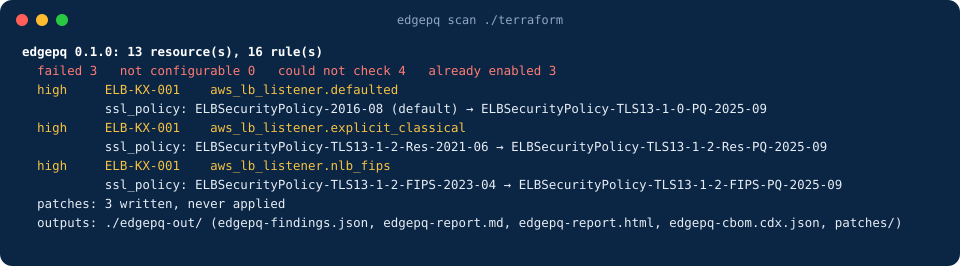

<p align="center"></p>

<p align="center">
  <a href="https://github.com/infraedgecloud-tools/edgepq/releases/latest"></a>
  <a href="https://github.com/infraedgecloud-tools/edgepq/actions/workflows/ci.yml"></a>
  <a href="LICENSE"></a>
</p>

**EdgePQ says which of your AWS endpoints and keys still rely on classical cryptography,
and what to change.** It reads your Terraform or your account, names the load balancer
listeners, API Gateway domains, CloudFront distributions and KMS keys that negotiate a
key exchange a quantum computer could later break, and gives the one-line fix for each,
with the AWS documentation it rests on.

Traffic recorded today can be decrypted later ("harvest now, decrypt later"). AWS has
shipped hybrid post-quantum key exchange (ML-KEM) on most of its TLS front doors as a
policy setting. Whether it is on is a configuration question, and that is what EdgePQ
answers. Nothing is ever called safe or compliant, and nothing is ever applied.

<p align="center"></p>

## Try it in a minute

```bash
npm install -g https://github.com/infraedgecloud-tools/edgepq/releases/download/v0.2.0/infraedgecloud-edgepq-0.2.0.tgz
edgepq scan ./terraform
```

Needs Node 20.10 or later. The summary prints to the terminal and the files land in
`./edgepq-out/`:

```
edgepq-out/
  edgepq-findings.json     every finding, with observed values, the fix and dated sources
  edgepq-findings.sarif    the failures and could-not-checks, for GitHub code scanning
  edgepq-report.md         the same, readable
  edgepq-report.html       the same, self-contained, no external requests
  edgepq-cbom.cdx.json     CycloneDX 1.6 cryptographic bill of materials
  patches/                 one unified diff per fix, plus edgepq-auto.patch and edgepq-all.patch
```

No account, no upload, no telemetry: `scan` reads files and writes files. The same
scanner runs in a browser as [EdgePQ Check](https://infraedgecloud.com/tools/edgepq-check),
for a paste-and-see answer.

## Install

| | |
|---|---|
| Release tarball | `npm install -g https://github.com/infraedgecloud-tools/edgepq/releases/download/v0.2.0/infraedgecloud-edgepq-0.2.0.tgz` |
| From source | `git clone https://github.com/infraedgecloud-tools/edgepq && cd edgepq && npm ci && node bin/edgepq.js` (Node 22.18 or later runs the TypeScript directly) |

Checked on 2026-10-20 against the published v0.2.0 release, on Linux arm64 with Node
24.21.0: the tarball matches `SHA256SUMS`, installs into a clean prefix with
`--ignore-scripts`, reports `0.2.0`, and scans a Terraform directory. This README
describes v0.2.0; `main` is the same commit as the tag.

`npm install -g @infraedgecloud/edgepq` does not work yet — the registry answers 404.
The package is unpublished until the scope and a publish token exist ([#12](https://github.com/infraedgecloud-tools/edgepq/issues/12)), so the release
tarball is the install path.

Each release tarball carries a [build provenance attestation](https://docs.github.com/en/actions/security-for-github-actions/using-artifact-attestations).
Verify it before you install:

```bash
gh attestation verify infraedgecloud-edgepq-0.2.0.tgz --owner infraedgecloud-tools
```

Checked today against the published tarball: it passes.

## Four surfaces, one engine

| Command | Input | Output |
|---|---|---|
| `edgepq scan <dir>` | Terraform HCL | findings, SARIF, report, CBOM, patches |
| `edgepq scan <plan.json>` | `terraform show -json` plan or state | findings, SARIF, report, CBOM |
| `edgepq aws` | read-only API calls across accounts and regions | findings, report, CBOM, evidence |
| `edgepq verify <host>` | a few TLS connections | the key exchange the endpoint selects, and whether a hybrid handshake completes |

Exit policy: `scan` and `aws` exit 1 when a failed finding reaches `--fail-on SEV`, and 2 for input or execution failures. `scan` exits 2 for zero resources or HCL parse errors. A valid no-op JSON document is recognised, but its empty scope still exits 2 under the scan policy.

AWS collection has a separate `input.status`: `complete`, `partial`, or `failed`, with an account/region/service ledger in `input.coverage`. Enabled regions are discovered independently for each account. Global CloudFront collection runs once per account in `us-east-1`. Only the commercial `aws` partition is supported. Successful enumeration with no resources is complete; denied or unobserved scopes are not empty inventories.

`aws --coverage strict` is the default: partial or failed collection exits 2 regardless of `--fail-on`. `--coverage advisory` explicitly permits partial collection, with a warning, while zero usable collection still exits 2. Disabling CloudTrail sampling records an excluded scope, which cannot by itself make collection successful. Complete collection describes enumeration, not universal PQ readiness or a complete CloudTrail history.

`verify` exits 0 only after a real hybrid key exchange completes, 1 for classical or TLS 1.2 evidence, and 2 for inconclusive results or unreachable hosts. Key exchange and certificate authentication are separate evidence: inspect each handshake's `authenticated` and `authentication_error` fields. A completed hybrid exchange with an unauthenticated certificate is not an authenticated endpoint identity.

### Scanning Terraform

A directory is read the way Terraform reads it. The `*.tf` files in it are the root
module; each `module` block with a local source (`./modules/alb`) is read under
`module.<name>` with the values the call passes in, and a `var.x` inside a module
resolves to that value, or to the variable's default, which the report lists as an
assumption. A directory under the target that nothing calls is read as a root of its
own, with its path as the address prefix (`modules/alb:aws_lb_listener.https`), so a
repository of modules can be scanned too. Modules from a registry or a remote source
are not read; the report says so.

Anything the engine cannot resolve offline, an expression, a value from a data source,
is *could not check*, never a pass and never a fail. The report lists every such item.

```bash
edgepq scan ./terraform --fail-on high        # exit 1 if a high or critical finding failed
terraform show -json tfplan > plan.json && edgepq scan plan.json
```

In GitHub Actions, the SARIF file turns the failures into code scanning alerts on the
resource block, keyed on a fingerprint that survives a file move:

```yaml
- run: npm install -g https://github.com/infraedgecloud-tools/edgepq/releases/download/v0.2.0/infraedgecloud-edgepq-0.2.0.tgz
- run: edgepq scan ./terraform --out edgepq-out
  continue-on-error: true
- uses: github/codeql-action/upload-sarif@v3
  with:
    sarif_file: edgepq-out/edgepq-findings.sarif
```

Every finding in the JSON carries `fingerprint` (rule, resource type and address, hashed)
beside its `id` (rule, file and address): key a suppression or a ticket on the
fingerprint. Each rule carries a `version` that moves when its logic changes, and a
finding records the version that produced it.

### Scanning an account

Read-only, and every IAM action is named one by one: apply
[`terraform/edgepq-readonly-role/`](terraform/edgepq-readonly-role/) in each account to
be scanned. The role reads listener, distribution, API Gateway domain and API, KMS key,
ACM certificate and Private CA metadata, and the 90-day CloudTrail event history for the
client sample; it reads no function code, no environment variables and no secrets.

```bash
edgepq aws                                                   # the account your credentials belong to, every enabled region
edgepq aws --regions eu-west-2,us-east-1
edgepq aws --accounts 222222222222,333333333333 --role-name edgepq-readonly --external-id ...
edgepq aws --org --role-name edgepq-readonly                  # every active account in the organization
```

The CloudTrail sample (`--cloudtrail-sample N`, default 200 per service and region, `0`
to disable) reads KMS and Secrets Manager calls and reports which clients negotiated
classical key exchange, by user agent. `--org` additionally needs
`organizations:ListAccounts` on the principal running the scan.

### Verifying an endpoint

```bash
edgepq verify api.example.com
edgepq verify 203.0.113.10:8443 --servername api.example.com --json
```

Sends a browser-like TLS 1.3 ClientHello and reports the group the server put in its
ServerHello, then a hybrid-only offer, then one real handshake per group through Node's
own TLS stack. The verdict is one of `hybrid_selected`,
`hybrid_supported_not_preferred`, `hybrid_supported_preference_unknown`, `classical_only`, `tls_1_2_only`, `inconclusive`,
with the evidence beside it. The real handshakes need Node 22.20 or later (the OpenSSL
that can negotiate the hybrid groups); on an older Node they are reported as not
testable; placeholder ML-KEM shares, ServerHello selections and HelloRetryRequests alone cannot yield a successful hybrid verdict. Mixed transient and definitive hybrid failures remain inconclusive. Each connection has an absolute timeout (default 5000 ms, maximum 60000 ms); a raw server flight is capped at 65536 bytes. The full probe can take about three timeout periods.

### Output ownership and recovery

Use a fresh empty `--out` directory for the first run. EdgePQ records its generated files in `.edgepq-output.json`; later runs replace the whole owned output, removing patches from older findings. A nonempty legacy output without a manifest, user additions, missing files, symlinks, and filename collisions are refused. Preserve or move those files and choose a new empty directory. Generated patches are suggestions and are never applied.

Outputs are staged beside the destination, with an exclusive `<out>.edgepq-lock`, then directories are renamed. This is staged replacement, not a crash-atomic filesystem transaction. Process termination can leave the destination absent, a `.<name>-run-*-previous` backup, a staging directory, and a lock. No run publishes a mixture of old and new files. After confirming no EdgePQ process is active, preserve the prior directory if needed and choose a new empty output path. Remove only the identified generated staging/backup/lock paths after inspection. EdgePQ does not recursively delete an arbitrary chosen directory. Filesystem errors still exit 2; writable-path testing under an unprivileged account and Windows crash recovery remain release gates.

### Input and evidence limits

JSON major format 1 is supported; newer minor fields are tolerated. Incomplete or errored plans, unknown actions, malformed managed resources, and malformed state structures fail rather than silently passing. `applyable: false` alone is not an error. Inputs are limited to 16 MiB per file, 64 MiB total, 10000 Terraform source files and 64 directory/value levels. Terraform input symlinks are refused. These are bounded checks, not a full Terraform evaluator: module instance expansion, dynamic blocks and unresolved expressions can remain unknown. No repository code is executed to resolve them.

CloudTrail is a capped recent event sample, not proof of all clients or traffic. Missing events, events without TLS details, disabled sampling and zero evidence must not be read as PQ use. Review `no_tls_details`, sample counts and coverage. AWS requests use at most three attempts, 2-second connection and 10-second request/socket timeouts. `aws --timeout MS` sets the total run deadline (default 120000, maximum 3600000); cancellation propagates to service requests and AssumeRole. Scopes are capped at 100 accounts, 100 explicit regions, 5000 collection combinations and 1000 pages per stream. Repeated continuation tokens fail collection. Credential-provider startup follows the SDK provider chain; configure credentials explicitly in CI. Independent current-source revalidation of every AWS rule claim, broader HCL semantics and large-monorepo benchmarking remain pending; see `docs/release-evidence.md`.

## What it checks

`edgepq rules` prints every rule with its sources and the date each was verified. In
short:

- **Key exchange (harvest now, decrypt later), ranked first.** ALB and NLB listener
  policies; API Gateway custom domains and REST API endpoints; CloudFront viewer policy;
  KMS RSA encryption keys and ECDH key agreement.
- **Clients.** Which SDKs actually negotiate ML-KEM with KMS and Secrets Manager, from
  CloudTrail (`aws` only).
- **Signatures, ranked after.** KMS signing keys; Private CA key algorithms.
- **Inventory.** ACM certificates and everything above, in the CBOM.

What it does not look at is printed at the top of every report: CloudFront to origin,
Transfer Family, Classic Load Balancers, HTTP API default endpoints, KMS replica and
external keys, application code, other clouds.

Rules are YAML under [`rules/`](rules/), one file each, with a failing and a passing
fixture under `test/fixtures/rules/`. The findings JSON is described by
[`schema/findings.schema.json`](schema/findings.schema.json).

## Developing

```bash
npm ci
npm run check            # typecheck + every test; no network
EDGEPQ_NET=1 npm test    # also a probe test against a live AWS endpoint
npm run build            # dist/ (the package) and dist/web/ (the browser bundle)
```

[CONTRIBUTING.md](CONTRIBUTING.md) covers adding a rule, [SECURITY.md](SECURITY.md) what
counts as a security issue, [CHANGELOG.md](CHANGELOG.md) what changed.

## Licence

Apache-2.0. See [LICENSE](LICENSE), [NOTICE](NOTICE) and [TRADEMARKS.md](TRADEMARKS.md).
EdgePQ is built by [InfraEdge](https://infraedgecloud.com).
